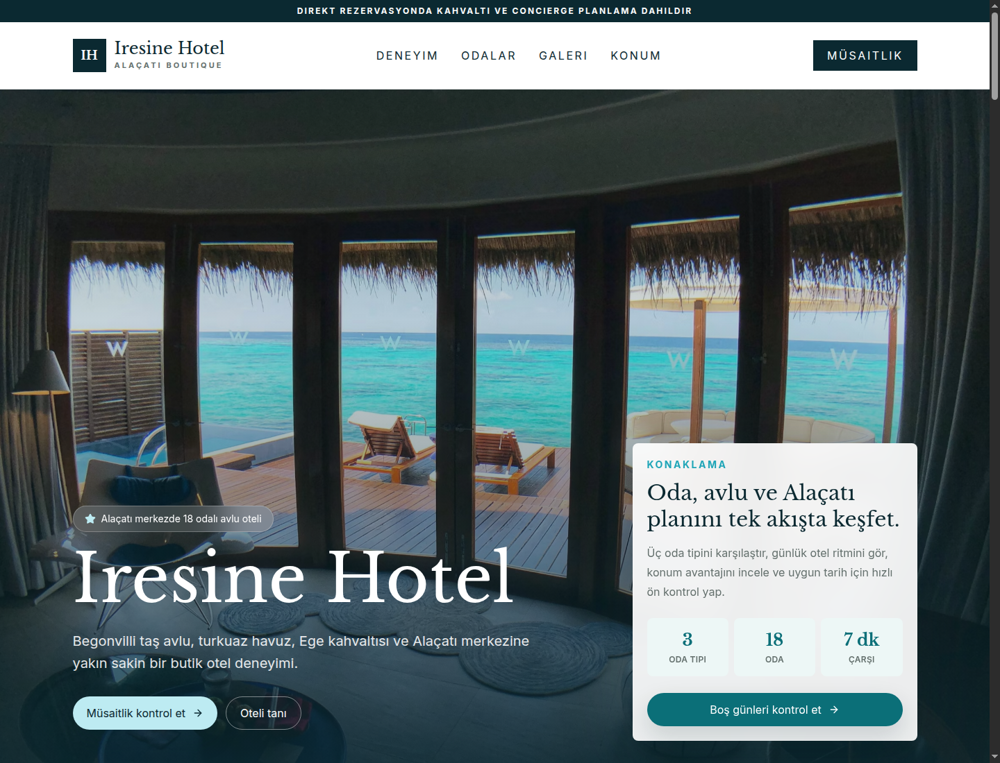

<div align="center">

# Iresine Hotel

**Alaçatı'daki kurgusal bir butik otel için web sitesi prototipi. React, TypeScript ve Vite ile.**


[Öne çıkanlar](#öne-çıkanlar) · [Ekran görüntüleri](#ekran-görüntüleri) · [Kurulum ve çalıştırma](#kurulum-ve-çalıştırma) · [Sayfalar](#sayfalar) · [Müsaitlik kontrolü](#müsaitlik-kontrolü)



</div>

Alaçatı merkezde 18 odalı bir butik otel için hazırlanmış, tek sayfalı bir web sitesi prototipi. Ziyaretçi odaları karşılaştırır, seçtiği tarih için ön müsaitliğe bakar, galeriyi ve konum bilgisini inceler. React 19, TypeScript, Vite ve Tailwind CSS 4 ile yazıldı; arka uç ve veritabanı yoktur, içerik kod içindeki statik veriden gelir.

Iresine Hotel kurgusal bir oteldir; sitedeki adres, iletişim bilgileri, fiyatlar ve doluluk takvimi örnek veridir.

## Öne çıkanlar

- **Altı sayfa:** ana sayfa, deneyim, odalar, müsaitlik, galeri ve konum tek bir React uygulamasında.
- **Oda vitrini:** üç oda tipi (Courtyard Room, Garden Suite, Pool House) alan, kişi sayısı ve gecelik fiyatla kartlarda karşılaştırılır.
- **Oda detayı:** her oda için uzun açıklama, öne çıkanlar, oda imkanları ve üç fotoğraflık galeri.
- **Ön müsaitlik kontrolü:** oda, giriş günü, gece (1-14) ve misafir (1-4) seçilir; sonuç tarayıcıda hesaplanır ve çakışan günler listelenir.
- **Takvim:** pazartesi başlangıçlı aylık görünüm; giriş günü, konaklama, dolu ve geçmiş günler ayrı renkte gösterilir.
- **Tahmini toplam:** gece ve misafir sayısına göre EUR cinsinden tutar gösterilir.
- **Galeri:** 10 fotoğraflık ızgara ve beş koleksiyon (avlu ve havuz, odalar, kahvaltı ve restoran, Alaçatı sokakları, sahil ve koy rotaları).
- **Konum:** gömülü Google Maps haritası, adres kartı ve dört noktaya süre bilgisi (çarşı, Ilıca Plajı, sörf okulları, Çeşme Marina).
- **Konsiyerj içeriği:** transfer, restoran rezervasyonu, koy rotası ve özel kutlama hizmetleri deneyim ve konum sayfalarında anlatılır.
- **Gezinme:** yönlendirme kütüphanesi yok; History API ile adres çubuğu güncellenir, tarayıcının geri tuşu çalışır.
- **Mobil uyum:** dar ekranda tam ekran menü açılır; düzen Tailwind kırılım noktalarıyla uyarlanır.

## Ekran görüntüleri

<table>
  <tr>
    <td width="50%"></td>
    <td width="50%"></td>
  </tr>
  <tr>
    <td align="center">Odalar sayfası</td>
    <td align="center">Galeri sayfası</td>
  </tr>
</table>

Üstteki büyük görsel: ana sayfa.

## Gereksinimler

- Node.js 20.19 ve üzeri ya da 22.12 ve üzeri (kilit dosyasındaki `@vitejs/plugin-react` 5.2.0 sürümünün koşulu) ve npm.
- İnternet bağlantısı. Fotoğraflar Unsplash'ten, yazı tipleri Google Fonts'tan, harita Google Maps'ten çalışma anında yüklenir.

## Kurulum ve çalıştırma

```bash
git clone https://github.com/ismailarat56/boutique-hotel.git
cd boutique-hotel
npm install
npm run dev
```

Geliştirme sunucusu `http://localhost:3000` adresinde açılır. `.env` dosyası oluşturmak gerekmez; `src/` altındaki kod ortam değişkeni okumaz.

| Komut | İşlev |
|---|---|
| `npm run dev` | Vite geliştirme sunucusu, port 3000, `--host=0.0.0.0` ile |
| `npm run build` | üretim derlemesi (`dist/`) |
| `npm run preview` | derlenen çıktıyı yerelde sunar |
| `npm run lint` | TypeScript tip denetimi (`tsc --noEmit`) |
| `npm run clean` | `dist` klasörünü siler (`rm -rf` kullanır; Windows'ta `rm` komutu olan bir kabuk gerekir) |

## Sayfalar

Arayüz dili Türkçedir.

| Sayfa | Adres | İçerik |
|---|---|---|
| Ana sayfa | `/` | otel tanıtımı, oda önizlemesi, hizmetler, konum özeti, rezervasyon çağrısı |
| Deneyim | `/experience` | günün akışı, olanaklar, bahçe restoranı, hizmet sözü |
| Odalar | `/rooms` | oda kartları, oda detayı, oda konforları |
| Müsaitlik | `/availability` | takvim, oda seçimi, ön müsaitlik sonucu |
| Galeri | `/gallery` | fotoğraf ızgarası ve koleksiyonlar |
| Konum | `/location` | harita, iletişim kartı, mesafeler, yerel rehber |

Yol eşlemesi `src/lib/navigation.ts` dosyasındadır. Tanınmayan adresler ana sayfayı açar. Oda detayının ayrı bir adresi yoktur; `/rooms` içinde gösterilir.

## Müsaitlik kontrolü

- Dolu günler `src/data/hotel.ts` içindeki `unavailableDates` nesnesinde, oda başına ISO tarih listesi olarak durur.
- `src/lib/availability.ts` içindeki `getAvailability`, giriş gününden başlayıp gece sayısı kadar günü üretir ve dolu günlerle karşılaştırır.
- "Bugün" `src/data/hotel.ts` içindeki `todayIso` sabitidir (`2026-05-20`); bundan önceki günler seçilemez.
- Tahmini toplam `src/App.tsx` içinde hesaplanır: gecelik 210 EUR, ikiden fazla misafirde 245 EUR.

## Klasör yapısı

```
src/
  App.tsx              etkin sayfa, gezinme ve müsaitlik formunun durumu
  main.tsx             React giriş noktası
  index.css            Tailwind teması (renkler, yazı tipleri) ve ortak sınıflar
  types.ts             Room, Page ve ortak tipler
  data/hotel.ts        odalar, olanaklar, galeri koleksiyonları, mesafeler, dolu günler
  lib/                 availability (tarih ve takvim), navigation (yol eşlemesi), motion (animasyon ayarı)
  components/layout/   üst menü, alt bilgi, sayfa sonu çağrı bloğu
  components/ui/       sayaç, rozet, bilgi kartı gibi küçük bileşenler
  features/            sayfa bölümleri: home, experience, rooms, availability, gallery, location
public/screenshots/    README görselleri
```

## Bilinen eksikler

- Rezervasyon ve ödeme yok. Müsaitlik sonucu ön kontroldür; sonuç kartındaki tek eylem otele e-posta bağlantısıdır.
- Doluluk takvimi ve "bugün" tarihi kodda sabittir; gerçek tarihe göre ilerlemez.
- Tahmini toplam seçilen oda tipinin fiyatını kullanmaz; her oda için aynı gecelik tutarla hesaplanır.
- `package.json` içinde `src/` tarafından içe aktarılmayan bağımlılıklar var: `@google/genai`, `express`, `dotenv`.
- Otomatik test yok. Yalnızca `npm run lint` ile tip denetimi yapılır.

## Lisans

Kod [MIT lisansı](LICENSE) ile sunulur. Sitedeki fotoğraflar Unsplash'ten bağlantıyla yüklenir; repoda yalnızca ekran görüntüleri bulunur.
