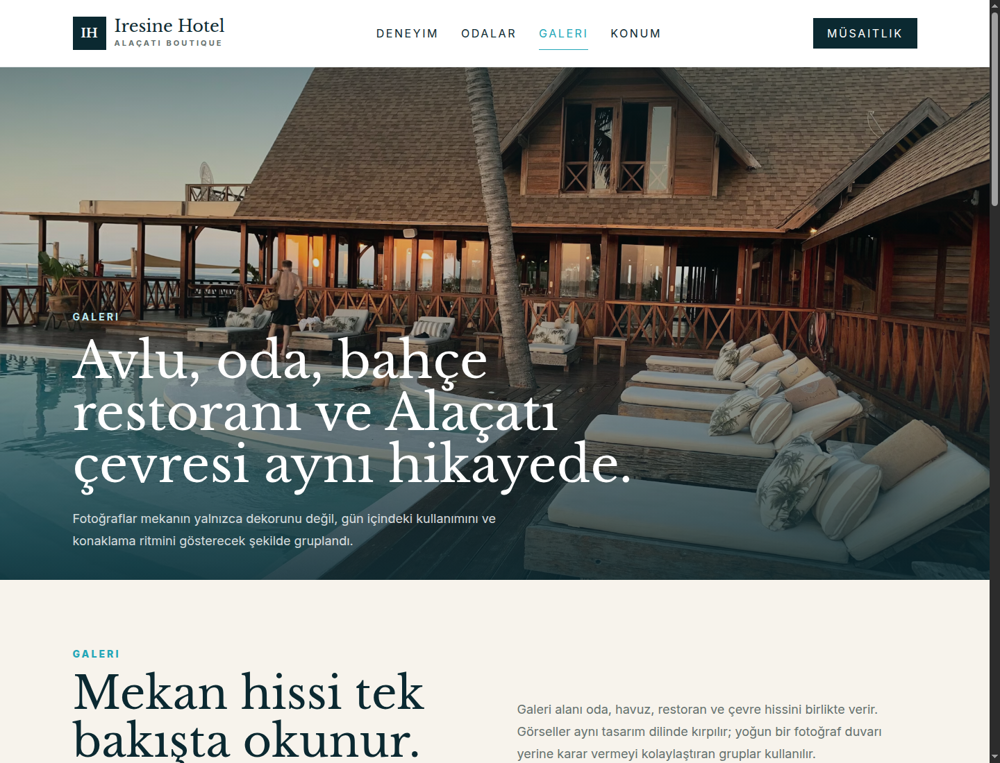

**English** · [Türkçe](README.tr.md)

<div align="center">

# Iresine Hotel

**A website prototype for a fictional boutique hotel in Alaçatı. Built with React, TypeScript and Vite.**


[Highlights](#highlights) · [Screenshots](#screenshots) · [Setup and running](#setup-and-running) · [Pages](#pages) · [Availability check](#availability-check)


</div>

A single-page website prototype for an 18-room boutique hotel in the centre of Alaçatı. The visitor compares rooms, checks preliminary availability for a chosen date, and browses the gallery and the location details. It is written with React 19, TypeScript, Vite and Tailwind CSS 4. There is no back end and no database; the content comes from static data in the code.

The user interface is in Turkish.

Iresine Hotel is a fictional hotel. The address, contact details, prices and occupancy calendar on the site are sample data.

## Highlights

- **Six pages:** home, experience, rooms, availability, gallery and location in a single React application.
- **Room showcase:** three room types (Courtyard Room, Garden Suite, Pool House) are compared on cards by area, number of guests and nightly price.
- **Room detail:** a long description, highlights, room amenities and a three-photo gallery for each room.
- **Preliminary availability check:** the visitor selects a room, a check-in day, nights (1-14) and guests (1-4). The result is calculated in the browser and the conflicting days are listed.
- **Calendar:** a monthly view that starts on Monday. The check-in day, the stay, booked days and past days are shown in different colours.
- **Estimated total:** an amount in EUR is shown based on the number of nights and guests.
- **Gallery:** a 10-photo grid and five collections (courtyard and pool, rooms, breakfast and restaurant, Alaçatı streets, coast and cove routes).
- **Location:** an embedded Google Maps map, an address card and travel times to four places (the town centre, Ilıca Beach, the surf schools, Çeşme Marina).
- **Concierge content:** transfer, restaurant reservation, cove route and private celebration services are described on the experience and location pages.
- **Navigation:** no routing library. The address bar is updated with the History API, and the browser's back button works.
- **Mobile layout:** a full-screen menu opens on narrow screens. The layout adapts with Tailwind breakpoints.

## Screenshots

<table>
  <tr>
    <td width="50%"></td>
    <td width="50%"></td>
  </tr>
  <tr>
    <td align="center">Rooms page</td>
    <td align="center">Gallery page</td>
  </tr>
</table>

The large image at the top: the home page.

## Requirements

- Node.js 20.19 or later, or 22.12 or later (required by `@vitejs/plugin-react` 5.2.0 in the lock file), and npm.
- An internet connection. Photos are loaded from Unsplash, fonts from Google Fonts and the map from Google Maps at runtime.

## Setup and running

```bash
git clone https://github.com/ismailarat56/boutique-hotel.git
cd boutique-hotel
npm install
npm run dev
```

The development server opens at `http://localhost:3000`. You do not need to create a `.env` file; the code under `src/` does not read environment variables.

| Command | What it does |
|---|---|
| `npm run dev` | Vite development server, port 3000, with `--host=0.0.0.0` |
| `npm run build` | production build (`dist/`) |
| `npm run preview` | serves the built output locally |
| `npm run lint` | TypeScript type check (`tsc --noEmit`) |
| `npm run clean` | deletes the `dist` folder (uses `rm -rf`; on Windows it needs a shell that has the `rm` command) |

## Pages

The interface language is Turkish.

| Page | Path | Content |
|---|---|---|
| Home | `/` | hotel introduction, room preview, services, location summary, booking call to action |
| Experience | `/experience` | flow of the day, amenities, garden restaurant, service promise |
| Rooms | `/rooms` | room cards, room detail, room comforts |
| Availability | `/availability` | calendar, room selection, preliminary availability result |
| Gallery | `/gallery` | photo grid and collections |
| Location | `/location` | map, contact card, distances, local guide |

The path mapping is in `src/lib/navigation.ts`. Unknown paths open the home page. The room detail has no path of its own; it is shown inside `/rooms`.

## Availability check

- Booked days are kept in the `unavailableDates` object in `src/data/hotel.ts`, as a list of ISO dates per room.
- `getAvailability` in `src/lib/availability.ts` generates one day per night, starting from the check-in day, and compares them with the booked days.
- "Today" is the `todayIso` constant in `src/data/hotel.ts` (`2026-05-20`); days before it cannot be selected.
- The estimated total is calculated in `src/App.tsx`: 210 EUR per night, or 245 EUR with more than two guests.

## Folder structure

```
src/
  App.tsx              active page, navigation and the state of the availability form
  main.tsx             React entry point
  index.css            Tailwind theme (colours, fonts) and shared classes
  types.ts             Room, Page and shared types
  data/hotel.ts        rooms, amenities, gallery collections, distances, booked days
  lib/                 availability (dates and calendar), navigation (path mapping), motion (animation settings)
  components/layout/   header menu, footer, end-of-page call-to-action block
  components/ui/       small components such as a counter, a badge and an info card
  features/            page sections: home, experience, rooms, availability, gallery, location
public/screenshots/    README images
```

## Known gaps

- No booking and no payment. The availability result is a preliminary check; the only action on the result card is an email link to the hotel.
- The occupancy calendar and the "today" date are fixed in the code; they do not move with the real date.
- The estimated total does not use the price of the selected room type; it is calculated with the same nightly amount for every room.
- `package.json` contains dependencies that `src/` does not import: `@google/genai`, `express`, `dotenv`.
- No automated tests. The only check is the type check with `npm run lint`.

## License

The code is released under the [MIT license](LICENSE). The photos on the site are loaded from Unsplash by link; the repo contains only the screenshots.
